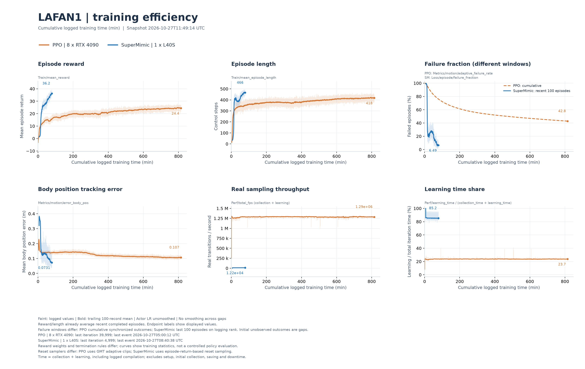

# SuperMimic Lite

An **unofficial reproduction of SuperMimic** for Unitree G1 motion tracking, built on [mjlab](https://github.com/mujocolab/mjlab) and MuJoCo Warp. It learns a dynamics model from simulator transitions and trains a policy through imagined rollouts.

This repository has received **only basic testing on LAFAN1**, hence **Lite**. Reward terms, weights and other training settings differ from the original paper. The results below describe this implementation and do not reproduce the paper's experimental setup.

## LAFAN1 experiment

The experiment uses 40 retargeted G1 motion clips at 50 Hz:

- **SuperMimic Lite:** 1 × NVIDIA L40S, **4,096 environments**.
- **PPO baseline:** 8 × NVIDIA RTX 4090, **8,192 environments per GPU** (65,536 total).

The full-motion evaluations below were completed on 2026-10-27 using 40 parallel environments, starting each clip at frame zero with seed 42. Both methods use the same evaluation protocol, with randomization and reset, observation and action noise disabled. A motion succeeds when it reaches the end without a failure termination.

| Method | Checkpoint | Logged training time | Real environment steps | Successful motions | Success rate |
| --- | --- | ---: | ---: | ---: | ---: |
| PPO | `model_39999.pt` | 814.9 min (13.58 h) | 62,914,560,000 | 24/40 | 60.0% |
| **SuperMimic Lite** | `model_13500.pt` | **211.5 min (3.52 h)** | **138,371,072** | **39/40** | **97.5%** |

The plotted runs stop at these evaluated checkpoints: 40,000 PPO updates and 13,500 SuperMimic updates. Real environment steps count simulator transitions across all environments and GPUs; SuperMimic's count includes initial collection and excludes imagined rollouts. SuperMimic's mean motion completion is 97.61%, with `fallAndGetUp1_subject1` the only failed clip.



These runs use different hardware and training configurations. Logged training time covers collection and learning, including logged compilation, but excludes setup, initial collection, checkpoint saving and downtime. PPO's training failure statistic is cumulative; SuperMimic Lite's covers the latest 100 completed episodes on the logging rank. This is a basic comparison on the training motion library, not a held-out benchmark.

## Installation

Install [uv](https://docs.astral.sh/uv/), then run from the repository root. Python 3.11–3.13 is supported; the repository defaults to 3.13.

```bash
uv sync --locked --extra cu128 --no-dev
```

The pinned official mjlab dependency is installed automatically. For CPU use, replace `--extra cu128` with `--extra cpu` and select `--device cpu` in the commands below. Use `uv run --no-sync` to keep the installed Torch variant.

## Download LAFAN1 from Hugging Face

**This repository does not distribute LAFAN1 or the processed motion files used in the experiment.** Download the public G1 retargets from [lvhaidong/LAFAN1_Retargeting_Dataset](https://huggingface.co/datasets/lvhaidong/LAFAN1_Retargeting_Dataset). Its `g1/` folder contains 30 Hz CSV files with root position, an `xyzw` root quaternion and 29 joint angles. This upstream retargeting is a separate data source; the historical results above are not a benchmark of the conversion below.

1. Download only the G1 CSV files using the [Hugging Face CLI](https://huggingface.co/docs/huggingface_hub/guides/cli):

   ```bash
   uvx --from huggingface-hub hf download lvhaidong/LAFAN1_Retargeting_Dataset \
     --repo-type dataset --include 'g1/*.csv' \
     --local-dir motions/lafan1_hf
   ```

2. Convert them locally to the 50 Hz tracking NPZ format. This runs on CPU, resamples the trajectories and computes body kinematics:

   ```bash
   uv run --no-sync supermimic data csv \
     --input-dir motions/lafan1_hf/g1 \
     --output-dir motions/lafan1_g1_rtgt_50hz \
     --input-fps 30 --output-fps 50
   ```

3. Configure the generated folder as `motion_folder` below. Downloaded CSVs and generated NPZs stay under the Git-ignored `motions/` directory. Dataset usage is governed by the upstream dataset's terms.

For a fresh checkout, convert the data before creating the asset configuration. If you already have one, select an output directory outside its `protected_roots`. Keep the same motion files when resuming a run.

## Configure assets

Checkpoints and raw logs remain local and outside Git; checkpoint hosting on Hugging Face is planned separately.

```bash
cp assets.example.toml .supermimic.local.toml
```

Edit `motion_folder` to point to your 50 Hz tracking NPZ files. For playback, evaluation or resume, also set `checkpoint` and `run_dir`; the run directory must contain `params/env.yaml` and `params/agent.yaml`. Training from scratch only needs the motion folder.

Paths are relative to the TOML file and may point outside this repository. Command-line flags override configured paths. The local configuration is ignored by Git; `protected_roots` prevents outputs from overwriting preserved asset directories.

## Train

```bash
# One GPU; 4,096 environments and 10,000 learner iterations by default.
uv run --no-sync supermimic train --device cuda:0

# Two GPUs, with 4,096 environments per GPU.
uv run --no-sync supermimic train --gpu-ids '[0,1]'
```

One iteration is one complete learner update, including world-model, policy and critic updates. `--max-iterations 10000` sets the total target. Training writes checkpoints, configuration snapshots and TensorBoard logs under `checkpoints/`; use `--output-dir` to select a new run directory. The first CUDA learner update includes compilation time.

Use `uv run --no-sync supermimic train --help-full` for additional options, such as `--env.scene.num-envs 1024`.

### Resume

```bash
uv run --no-sync supermimic train --resume \
  --checkpoint /path/to/run/model_5000.pt \
  --max-iterations 10000 \
  --output-dir checkpoints/resumed_run
```

Resuming iteration 5,000 with a target of 10,000 runs 5,000 additional iterations. Resume requires the original motion dataset, configuration snapshots and all matching `model_N.rankR.replay.pt` shards. Environment count, rank count and replay dimensions must match the saved run.

## Play and evaluate

```bash
# Interactive viewer; requires a display.
uv run --no-sync supermimic play --motion dance1_subject1

# Headless playback.
uv run --no-sync supermimic play --headless --steps 100 --device cuda:0

# Evaluate every motion from its first frame.
uv run --no-sync supermimic eval --num-envs 40 --device cuda:0 \
  --output-dir logs/eval/my_run
```

`--motion` selects an NPZ filename stem. Use `--checkpoint`, `--motion-folder` and `--run-dir` to override configured inputs. Playback and evaluation need the main checkpoint and configuration snapshots, without replay shards. Load only trusted checkpoints.

Evaluation produces `results.json`, `summary.csv` and `per_motion.csv`. Its output directory must be new or empty.

## Training plots

Plot a training run:

```bash
uv run --no-sync supermimic plot --source /path/to/run --output-dir logs/plots
```

Comparison plots use four panels for reward, episode length, failure fraction and body position error. Their legends include logged training time and real environment steps when available. A JSON source can set `max_iteration` to the last included zero-based iteration; for SuperMimic `model_N.pt`, use `N - 1` to align curves with that checkpoint.

## License and attribution

Code is licensed under [Apache-2.0](LICENSE) and maintained by [zzhanYoung](https://github.com/zzhanYoung). SuperMimic Lite is an unofficial reproduction; the original work is credited to the SuperMimic authors.

Task configuration, motion utilities and the environment step implementation derive in part from mjlab, maintained by the MuJoCo Lab contributors under Apache-2.0. The framework and robot assets are installed from official upstream. MuJoCo type-declaration generators are retained in `scripts/`; their generated `typings/` output is local development support, excluded from Git and release archives.

Checkpoints, motion data and raw logs are excluded from source distributions. Their provenance and distribution terms remain separate from the code license; LAFAN1 terms are documented in the [upstream dataset card](https://huggingface.co/datasets/lvhaidong/LAFAN1_Retargeting_Dataset).

## Model inputs and predictions

These choices describe the current G1 implementation. The actor uses a short feedback history and upcoming motion targets, while the critic and world model also receive simulator information available during training.

| Component | Selected inputs | Output and training |
| --- | --- | --- |
| **Actor** | Ten frames of 99 feedback features: torso-to-reference orientation (6), IMU angular velocity (3), projected gravity (3), relative joint positions (29), joint velocities (29), and previous actions (29); plus ten future reference frames (730 features). | Encodes the future reference into a 32-dimensional latent, combines it with the 990-dimensional feedback history, and predicts 29 joint-position actions, scaled and offset by the task's action configuration. |
| **Critic** | 914 privileged features: heading-invariant root/joint state (71), joint/body/root tracking errors (80), context (33), and future reference (730). | Predicts a scalar value, trained against detached lambda-return targets from imagined rollouts. |
| **World Model State** | Physical state (71): root position (3), quaternion (4), joint positions (29), root linear/angular velocities (6), and joint velocities (29). The model also receives the current action (29) and context (33). | Predicts 71 state increments, adds them to the current physical state, and normalizes the resulting quaternion. The current action becomes the next previous-action field. |
| **Context** | Shared foot friction (1), joint encoder biases (29), and torso center-of-mass offset (3), read from the simulator. | Supplied to the world model and critic and held fixed throughout each imagined rollout. Context is not predicted by a learned estimator. |

**Reference and feedback.** The ten future targets are read from the motion clip at frames `t+1` through `t+10`, clamped at the end. Each has 73 features: root displacement and 6D orientation in the current reference heading frame, root linear/angular velocities in each future root frame, joint positions, and joint velocities scaled by 0.1. The actor receives encoder bias through its joint-position observations, without a direct privileged context input.

**State prediction.** The stored state has 100 values: 71 physical values and 29 previous actions. Only the physical values are predicted. Root position is relative to the environment origin; root quaternion and linear velocity use world axes, and angular velocity uses root-body axes. The world model is fitted autoregressively over eight-step replay windows with normalized geometric state errors, including rotation error.

**Imagined learning.** The actor is optimized through 32-step differentiable imagined rollouts, with world-model and critic parameters frozen during the actor update. Forward kinematics reconstructs body states; rewards and soft termination are computed analytically. Future motion targets come from the dataset and advance with the rollout. The critic uses lambda returns with defaults `gamma=0.99` and `lambda=0.95`.

Implementation: [input selection](src/supermimic/learning/adapter.py), [networks](src/supermimic/learning/models.py), [state integration](src/supermimic/learning/dynamics.py), [analytic heads](src/supermimic/learning/heads.py), and [training updates](src/supermimic/learning/algorithm.py).
